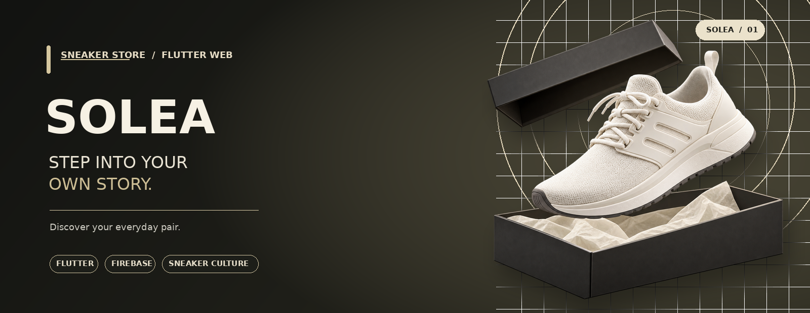

<p align="center">
  
</p>

<p align="center">
  <a href="https://flutter.dev/"></a>
  <a href="https://dart.dev/"></a>
  <a href="https://firebase.google.com/"></a>
  
</p>

<h1 align="center">SOLEA</h1>
<p align="center"><strong>A sneaker shopping experience built for everyday movement.</strong></p>
<p align="center">Aplikasi e-commerce sneakers berbasis Flutter Web dengan autentikasi Firebase dan penyimpanan data pengguna melalui Cloud Firestore.</p>

---

## The experience

SOLEA dirancang untuk menghadirkan pengalaman belanja sneakers yang sederhana dan modern — mulai dari menjelajahi katalog, melihat detail produk, sampai mengelola pesanan dari satu tempat.

<table>
  <tr>
    <td width="50%" valign="top">
      <h3>01 / Explore</h3>
      Jelajahi katalog sneakers, gunakan kategori, dan urutkan produk berdasarkan harga atau rating.
    </td>
    <td width="50%" valign="top">
      <h3>02 / Personalize</h3>
      Buat akun, kelola profil dan alamat, lalu simpan produk favorit ke wishlist.
    </td>
  </tr>
  <tr>
    <td width="50%" valign="top">
      <h3>03 / Shop</h3>
      Pilih ukuran dan jumlah, kelola keranjang, serta isi informasi pengiriman saat checkout.
    </td>
    <td width="50%" valign="top">
      <h3>04 / Track</h3>
      Lihat daftar pesanan dan temukan halaman bantuan atau kontak ketika diperlukan.
    </td>
  </tr>
</table>

## Feature overview

| Area | Yang tersedia |
|:--|:--|
| **Account** | Registrasi, login, logout, dan verifikasi email melalui Firebase Authentication |
| **Discover** | Katalog sneakers, kategori, pengurutan produk, dan halaman detail |
| **Shopping** | Pilihan ukuran, jumlah produk, keranjang belanja, dan wishlist |
| **Orders** | Form checkout dan halaman daftar pesanan |
| **Profile** | Informasi personal, alamat, keamanan akun, metode pembayaran, notifikasi, dan FAQ |
| **Support** | Halaman layanan dan kontak SOLEA |

## Built with

<p>
  
  
  
  
</p>

| Technology | Role |
|:--|:--|
| Flutter + Dart | UI dan logika aplikasi |
| Firebase Authentication | Autentikasi pengguna |
| Cloud Firestore | Penyimpanan data pengguna dan data terkait yang sudah dihubungkan |
| Firebase Hosting | Target deployment untuk versi web |

## Run locally

### Requirements

- Flutter SDK yang memenuhi batas SDK di `pubspec.yaml`
- Browser modern, misalnya Google Chrome
- Project Firebase dengan konfigurasi aplikasi yang sesuai

## Project structure

```text
lib/
├── controllers/     # Logika autentikasi dan aktivitas belanja
├── core/            # Tema, helper, dan komponen inti
├── models/          # Model data aplikasi
├── views/
│   ├── auth/        # Login dan registrasi
│   ├── home/        # Home, katalog, detail produk, layanan, kontak
│   ├── landing/     # Landing page
│   ├── order/       # Daftar pesanan
│   ├── profile/     # Profil dan pengaturan akun
│   └── shopping/    # Keranjang, checkout, dan wishlist
├── firebase_options.dart
└── main.dart

assets/images/       # Logo dan gambar produk
web/                 # Entry point Flutter Web
pubspec.yaml         # Dependencies dan konfigurasi Flutter
README.md
```

## Development notes

- Data katalog produk saat ini masih didefinisikan secara lokal di `ProductController`, belum diambil dari koleksi produk Firestore.
- Pembayaran checkout masih berupa simulasi; belum terhubung ke payment gateway.
- Fitur yang menggunakan Firebase memerlukan konfigurasi layanan dan Security Rules yang sesuai.
- Screenshot aplikasi dan tautan demo dapat ditambahkan setelah versi publik tersedia.

---

<p align="center">
  <sub>SOLEA · Sneaker Store · Built with Flutter</sub>
</p>
